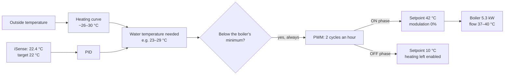

# Example: an 87 m² flat with screed underfloor heating and a 33 kW boiler

🇵🇱 [Polska wersja](pl/example.md)

> [!WARNING]
> The description and numbers come from the first days of this fork on one installation
> (November 2026). The code was written by Claude, an AI model; it has not been reviewed by a
> person or run for long on a real boiler. Another house will give other numbers.

This page follows one flat to show what SAT does with the boiler: where the water temperature comes from, when the burner runs, how hot water gets in the way and what SAT learns about the house. The general description is in [How SAT works](how-it-works.md) and [MPX additions](mpx.md).

- [The installation](#the-installation)
- [The problem: a boiler too big for the house](#the-problem-a-boiler-too-big-for-the-house)
- [From the reading to the burner](#from-the-reading-to-the-burner)
- [One burn up close](#one-burn-up-close)
- [Hot water and the cylinder](#hot-water-and-the-cylinder)
- [Loops and room thermostats](#loops-and-room-thermostats)
- [Heat budget](#heat-budget)
- [Windows, a lower target, an outage](#windows-a-lower-target-an-outage)
- [What the sensors show](#what-the-sensors-show)
- [Settings of this installation](#settings-of-this-installation)

## The installation

| | |
|---|---|
| Flat | 87 m², building finished in 2021 (Polish 2021 insulation standard) |
| Boiler | De Dietrich Lumea MPX 28/33 BIC, condensing, with a 40 l cylinder |
| Boiler power | 33 kW maximum, 16% minimum modulation → **about 5.3 kW** |
| Heating | screed underfloor heating, 8 loops |
| Loops | 4 with Afriso TSA-02 actuators (5–6 minutes to open) and Heatit Z-Temp2 thermostats, 4 always open (2 bathrooms, 2 corridors) |
| Connection | OpenTherm Gateway (OTGW) over serial |
| Main thermostat | De Dietrich AD289 iSense on the OpenTherm bus, through the gateway |
| Boiler limit | maximum flow temperature set to 45 °C in the boiler |

The gateway sits between the iSense and the boiler. It passes the thermostat's messages on, but replaces the water setpoint, the heating enable and the maximum modulation with SAT's values. The iSense room temperature (in tenths of a degree) is SAT's main sensor.

## The problem: a boiler too big for the house

SAT learned that the flat loses about **75–80 W per kelvin** of indoor–outdoor difference:

| Outside | Needed at 22 °C inside |
|---|---|
| +6 °C | 1.3 kW |
| 0 °C | 1.8 kW |
| −20 °C | 3.4 kW |

The boiler cannot go below 5.3 kW. Even in the coldest weather the house needs less than its minimum, so the boiler **always** has to run in bursts. The 33 kW were chosen for hot water (a shower takes about 24 kW), not for heating.

A plain thermostat or the boiler's own weather curve ends in short cycling: the burner lights every few minutes, burns briefly and goes out. Every start wastes gas, wears the ignition and condenses worse. SAT's aim in this flat: **few starts, long burns at minimum power, the coolest water possible.**

## From the reading to the burner

1. **Heating curve.** At +6 °C outside the curve (coefficient 1.3) asks for about 26 °C water, at 0 °C about 29 °C: what the floor would need with water flowing all the time.
2. **Room correction (PID).** A room too warm lowers that value, a room too cold raises it. In the evening at 22.4 °C with a 22 °C target it drops to about 23 °C.
3. **PWM.** The boiler cannot hold the water at 23–29 °C: its lowest power raises 15 l/min by about 5 K, and the boiler stops the burner before the water settles. So SAT splits each half hour in two:
   - **ON**: setpoint 42 °C (the learned overshoot protection value), modulation capped at its minimum. The boiler burns at 5.3 kW and never reaches 42 °C, so it does not cut out.
   - **OFF**: setpoint 10 °C, the burner goes out. Heating stays enabled (*Keep heating between PWM phases*), so the diverter valve does not switch every cycle.
4. **The ON phase** is as long as the missing heat requires. In November that was 3 minutes (room too warm) to 15 minutes (night, 0 °C) in every 30.

## One burn up close

A typical night burn at 0 °C outside:

| Time | What happens |
|---|---|
| 0:00 | SAT switches to the ON phase and sends 42 °C |
| 0:05 | the boiler lights; for a few seconds modulation reads 41% and the flow jumps to about 45 °C |
| 0:30 | modulation drops to 0%, which is 5.3 kW |
| 3:00 | the burn settles: flow 37–40 °C, return 33–35 °C, flue gas only about 3 K above the return |
| 15:00 | the ON phase ends, SAT sends 10 °C, the burner goes out |
| 15:00–30:00 | the pump keeps circulating, the screed gives its heat to the rooms |

Burning like this the boiler condenses fully; the estimated efficiency is about 96% (gross). On the night of 15–16 November it burned twice an hour for 11–15 minutes and the room stayed within ±0.1 °C.

## Hot water and the cylinder

The Lumea gives hot water priority and has a few habits SAT has to know about:

- **The cylinder cools when heating starts.** Each switch to space heating costs the cylinder 2–3 K, most likely because cool heating water briefly runs through its coil. After two or three starts it is down to about 45 °C and the boiler reheats it; on the first night every 90 minutes or so. The **Cylinder cooling by heating** sensor counts these drops; keeping heating enabled between phases is meant to prevent them.
- **Reheats without the flag.** The boiler does not always report over OpenTherm that it heats hot water. SAT tells such a burn from the water: when it rises more than 10 °C and ends up more than 10 °C above the setpoint within 20 seconds, the burn counts as hot water.
- **A burn cut for the cylinder.** When the cylinder needs heat during an ON phase, the boiler stops the heating burn after a dozen seconds and lights for the cylinder some 2 minutes later. SAT does not take that as overheating; if it did, it would advise a higher setpoint and turn off keep-heating.

## Loops and room thermostats

The four Z-Temp2 thermostats act as **limiters**: the bedroom at 22 °C, the others at 23 °C, above the target of the flat. Their loops are mostly open and close only when a room gets clearly too warm, from the sun for example.

In Eco mode SAT controls on the iSense and uses the room thermostats for:

- **whether any loop can take heat.** With all of them closed the boiler does not burn and the heat budget builds up no debt;
- **the sensors** *Open loops* and *Loops to rebalance* and the rotameter hints. SAT learns how much water each loop takes by comparing the flow under different sets of open valves;
- **the loop measurement** (`sat.measure_loops`), which opens the rooms one at a time and measures each loop.

With two room loops open the estimated flow is about 15 l/min, worked out from the burner power and the flow/return spread.

## Heat budget

The heat budget is meant to replace the short PWM phases with **one longer block an hour**. It first learns for about a day and a half in *Learn only (shadow)*, without touching the boiler.

- **Learning.** Every hour it records the heat burned, the temperature difference and the change of the room temperature, and fits the heat loss of the house over the last day. The first fit gave 80 W/K, a few hours later 74 W/K. Two independent methods agreed: at +6 °C the budget worked out 1.3 kW, and plain PWM burned 1.3 kW on average.
- **Dosing.** With the budget On, this flat at +6 °C gets a block of about 15 minutes an hour at 5.3 kW (1.3 kWh), at 0 °C about 20 minutes: one start an hour instead of two.
- **Credit.** Heat that could not be delivered (a cylinder reheat during the block) carries over to the next hour. A room more than 0.7 °C too warm clears it.
- **A lower target.** After going from 22.5 to 22 °C the budget burns nothing until the room is within 0.2 °C of the new target; in a simulation of this flat that takes about 3 hours.
- **Not enough power.** If the house needed more than 5.3 kW, the budget would hand over to normal modulation. In this flat that is unlikely to happen.

## Windows, a lower target, an outage

- **Airing.** On 16 November the windows were open from 12:50 to 15:00. The room fell by 0.1 °C every 15–20 minutes, from 22.7 to 21.8 °C. Since 5.2.0.14 a drop of 0.3 °C within 30 minutes pauses the heating; on this data the pause would have started at 13:08 and lasted until 15:08 (2 hours at most).
- **The screed.** After the target is lowered by 0.5 °C the room comes down over several hours, as the screed gives back its heat. In the first hours without heating the room barely cools (the morning of 16 November, 9:30–12:50: −0.1 °C).
- **Home Assistant down.** After a few minutes without commands the gateway hands the boiler back to the iSense, so its own setpoint should be sensible (20–21 °C), not a setback.
- **Screed protection.** The boiler is limited to 45 °C flow, and SAT raises a repair issue when the flow stays above 55 °C for more than 3 minutes while heating.

## What the sensors show

Values from the evening of 16 November (+6 °C outside):

| Sensor / attribute | Value | Meaning |
|---|---|---|
| Error value | −0.4 °C | the room is 0.4 °C too warm |
| `pulse_width_modulation_duty_cycle` | 343 / 1456 s | burning 5.7 min in 30 |
| Heat loss of the house | 74 W/K | learned heat loss |
| Heat need | 0.94 kW | what the house needs now |
| Flame starts in the last hour | 2 | two cycles an hour |
| Estimated boiler efficiency | 96% | full condensing |
| `flue_return_gap` | 3 K | clean heat exchanger (issue above 12 K) |
| Estimated water flow | 15 l/min | with two room loops open |
| Central heating water pressure | 1.6 bar | normal |
| Heat for space heating / hot water | 36 / 9 kWh | since installation, about 20% for hot water |

The Lumea does not report its own start and hour counters (the boiler entities read 0), so SAT counts them itself: *Burner starts*, *Burner hours*, heat and gas.

## Settings of this installation

| Setting | Value | Why |
|---|---|---|
| Heating system | Underfloor | screed |
| Heating curve coefficient | 1.3 | SAT suggests 1.2–1.4 after learning |
| Heating mode | Eco | control on one sensor (the iSense) |
| Overshoot protection | on, 42 °C | the lowest setpoint at which the boiler does not cut out |
| Duty cycles per hour | 2 | long burns, few starts |
| Anti-cycling time | 10 min | the boiler's minimum pause |
| Valve opening time | 6 min | Afriso actuator travel time |
| Keep heating between PWM phases | on (under test) | the diverter valve does not switch every cycle |
| Heat budget | Learn only → On once learned | one block an hour |
| Detect open windows | on | the iSense reports tenths of a degree |
| Warm weather shutdown | on | heating stops on a warm daily mean |
| Boiler service | due 1 October 2027 | reminder in Repairs |

Recommended Z-Temp2 settings: report every 300 s (parameter 1) and on a 0.5 °C change (parameter 2), hysteresis 0.5 °C (parameter 10, the default).
