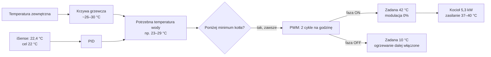

# Przykład: mieszkanie 87 m² z podłogówką i kotłem 33 kW

🇬🇧 [English version](../example.md)

> [!WARNING]
> Opis i liczby pochodzą z pierwszych dni pracy tego forka na jednej instalacji (listopad 2026).
> Kod napisał Claude, model AI; nie był sprawdzany przez człowieka ani używany dłużej na
> prawdziwym kotle. Wartości w innym domu będą inne.

Ta strona pokazuje na jednym konkretnym mieszkaniu, co SAT robi z kotłem: skąd bierze temperaturę wody, kiedy pali, jak radzi sobie z ciepłą wodą i czego uczy się o domu. Opis ogólny jest w [Jak działa SAT](how-it-works.md) i [Dodatki MPX](mpx.md).

- [Instalacja](#instalacja)
- [Problem: kocioł za duży dla domu](#problem-kocioł-za-duży-dla-domu)
- [Droga od pomiaru do palnika](#droga-od-pomiaru-do-palnika)
- [Jedno palenie z bliska](#jedno-palenie-z-bliska)
- [Ciepła woda i zasobnik](#ciepła-woda-i-zasobnik)
- [Pętle i termostaty pokojowe](#pętle-i-termostaty-pokojowe)
- [Budżet ciepła](#budżet-ciepła)
- [Okno, obniżenie temperatury, awaria](#okno-obniżenie-temperatury-awaria)
- [Co pokazują sensory](#co-pokazują-sensory)
- [Ustawienia tej instalacji](#ustawienia-tej-instalacji)

## Instalacja

| | |
|---|---|
| Mieszkanie | 87 m², budynek oddany w 2021 roku (Warunki Techniczne 2021) |
| Kocioł | De Dietrich Lumea MPX 28/33 BIC, kondensacyjny, z zasobnikiem 40 l |
| Moc kotła | 33 kW na ciepłą wodę, 28 kW na ogrzewanie (80/60 °C); minimum **4,7–5,1 kW** według danych technicznych. SAT liczy je jako 33 kW × 16% minimalnej modulacji (OpenTherm) = 5,3 kW, czyli o około 3% za dużo |
| Ogrzewanie | podłogówka w wylewce, 8 pętli |
| Pętle | 4 z siłownikami Afriso TSA-02 (otwierają się 5–6 minut) i termostatami Heatit Z-Temp2, 4 zawsze otwarte (2 łazienki, 2 korytarze) |
| Połączenie | bramka OpenTherm Gateway (OTGW) po łączu szeregowym |
| Termostat główny | De Dietrich AD289 iSense na magistrali OpenTherm, przez bramkę |
| Limity w kotle | P15 = 01: temperatura zadana c.o. najwyżej 45 °C; P12 = 0: moc c.o. najwyżej około 5 kW (fabrycznie 80, czyli 28 kW) |

Bramka siedzi między iSense a kotłem. Przekazuje kotłowi wiadomości termostatu, ale temperaturę zadaną wody, włączenie ogrzewania i maksymalną modulację podmienia na wartości z SAT. Temperatura z iSense (podawana co 0,1 °C) jest głównym czujnikiem SAT.

## Problem: kocioł za duży dla domu

SAT nauczył się, że mieszkanie traci około **75–80 W na każdy stopień** różnicy między środkiem a zewnątrz:

| Na zewnątrz | Potrzeba przy 22 °C w środku |
|---|---|
| +6 °C | 1,3 kW |
| 0 °C | 1,8 kW |
| −20 °C | 3,4 kW |

Kocioł nie zejdzie poniżej 5,3 kW. Nawet w największy mróz potrzeba jest mniejsza niż jego minimum, więc kocioł **zawsze** musi pracować z przerwami. Moc 33 kW dobrano pod ciepłą wodę (prysznic potrzebuje około 24 kW), nie pod ogrzewanie.

Zwykły termostat albo krzywa grzewcza w kotle kończą się wtedy taktowaniem: palnik zapala się co kilka minut, grzeje chwilę i gaśnie. Każdy start to strata gazu, zużycie zapłonu i gorsza kondensacja. Cel SAT w tym mieszkaniu: **mało startów, długie palenia na minimalnej mocy, jak najchłodniejsza woda.**

## Droga od pomiaru do palnika

1. **Krzywa grzewcza.** Przy +6 °C na zewnątrz krzywa (współczynnik 1,3) daje około 26 °C wody, przy 0 °C około 29 °C. To tyle, ile podłoga potrzebowałaby przy ciągłym przepływie.
2. **Korekta z pokoju (PID).** Gdy w pokoju jest za ciepło, SAT obniża tę wartość, gdy za zimno, podnosi. Wieczorem przy 22,4 °C i celu 22 °C żądana temperatura spada do około 23 °C.
3. **PWM.** Kocioł nie umie grzać wody do 23–29 °C: jego najniższa moc przy przepływie 15 l/min podnosi ją o około 5 K, a sterownik kotła wyłącza palnik, zanim woda się ustabilizuje. Dlatego SAT dzieli każde pół godziny na dwie fazy:
   - **ON**: temperatura zadana 42 °C (wyuczona wartość ochrony przed przegrzaniem), modulacja ograniczona do minimum. Kocioł pali na 5,3 kW i nie dochodzi do 42 °C, więc się nie wyłącza.
   - **OFF**: temperatura zadana 10 °C, palnik gaśnie. Ogrzewanie zostaje włączone (*Keep heating between PWM phases*), żeby zawór trójdrogowy nie przełączał się co cykl.
4. **Długość fazy ON** wynika z tego, ile ciepła brakuje. W listopadzie było to od 3 minut (pokój za ciepły) do 15 minut (noc, 0 °C) na każde 30 minut.

## Jedno palenie z bliska

Typowe nocne palenie przy 0 °C na zewnątrz:

| Czas | Co się dzieje |
|---|---|
| 0:00 | SAT przełącza na fazę ON i wysyła 42 °C |
| 0:05 | kocioł zapala; przez kilka sekund modulacja 41% i krótki skok zasilania do około 45 °C |
| 0:30 | modulacja schodzi do 0%, czyli 5,3 kW |
| 3:00 | palenie się stabilizuje: zasilanie 37–40 °C, powrót 33–35 °C, spaliny tylko około 3 K cieplejsze od powrotu |
| 15:00 | koniec fazy ON, SAT wysyła 10 °C, palnik gaśnie |
| 15:00–30:00 | pompa krąży, wylewka oddaje ciepło do pokoi |

Przy takim paleniu kocioł kondensuje w pełni. Szacowana sprawność to około 96% (na cieple spalania). W nocy z 15 na 16 listopada kocioł palił 2 razy na godzinę, po 11–15 minut, a temperatura w pokoju trzymała się w granicach ±0,1 °C.

## Ciepła woda i zasobnik

Lumea ma priorytet ciepłej wody i kilka cech, które SAT musi znać:

- **Zasobnik stygnie przy starcie grzania.** Przy każdym przełączeniu na ogrzewanie zasobnik traci 2–3 K, najpewniej przez krótki przepływ chłodnej wody grzewczej przez wężownicę. Po dwóch–trzech startach spada do około 45 °C i kocioł go dogrzewa. Pierwszej nocy było tak co około 90 minut. Sensor **Cylinder cooling by heating** liczy takie spadki. Utrzymanie ogrzewania włączonego między fazami ma tego uniknąć.
- **Dogrzewanie bez flagi.** Kocioł nie zawsze zgłasza przez OpenTherm, że grzeje wodę użytkową. SAT rozpoznaje takie palenie po wodzie: gdy w ciągu 20 sekund woda rośnie o ponad 10 °C i jest o ponad 10 °C cieplejsza od temperatury zadanej, palenie liczy się jako ciepła woda.
- **Przerwane palenie.** Gdy zasobnik potrzebuje ciepła w trakcie fazy ON, kocioł gasi palenie na ogrzewanie po kilkunastu sekundach i po około 2 minutach zapala dla zasobnika. SAT nie traktuje tego jako przegrzania. Gdyby tak traktował, doradzałby podnoszenie temperatury zadanej i wyłączał podtrzymanie grzania.

## Pętle i termostaty pokojowe

Cztery termostaty Z-Temp2 działają jak **ograniczniki**: sypialnia ma 22 °C, pozostałe 23 °C, czyli więcej niż cel całego mieszkania. Zwykle pętle są otwarte, a zamykają się tylko wtedy, gdy któryś pokój zrobi się wyraźnie za ciepły, na przykład od słońca.

SAT w trybie Eco grzeje według iSense, a termostatów pokojowych używa do:

- **sprawdzenia, czy jakaś pętla przyjmie ciepło.** Gdy wszystkie są zamknięte, kocioł nie pali, a budżet ciepła nie nalicza zaległości;
- **sensorów** *Open loops* i *Loops to rebalance* oraz podpowiedzi do rotametrów. SAT uczy się, ile wody bierze każda pętla, porównując przepływ przy różnych układach otwartych zaworów;
- **pomiaru pętli** (`sat.measure_loops`), który otwiera pokoje po kolei i mierzy przepływ każdej pętli.

Szacowany przepływ przy 2 otwartych pętlach pokojowych to około 15 l/min. Liczy się go z mocy palnika i różnicy zasilanie–powrót.

## Budżet ciepła

Budżet to dodatek, który zamiast krótkich faz PWM ma palić **jeden dłuższy blok na godzinę**. Najpierw przez około półtorej doby uczy się w trybie *Learn only (shadow)*, bez wpływu na kocioł.

- **Nauka.** Co godzinę zapisuje spalone ciepło, różnicę temperatur i zmianę temperatury w pokoju, a z ostatniej doby wylicza straty domu. Pierwsze dopasowanie wyszło 80 W/K, po kilku godzinach 74 W/K. Dwie niezależne metody dały to samo: przy +6 °C budżet liczył 1,3 kW, a zwykły PWM palił średnio 1,3 kW.
- **Dawkowanie.** Po włączeniu budżetu na On dla tego mieszkania przy +6 °C wychodzi blok około 15 minut na godzinę na 5,3 kW (1,3 kWh), przy 0 °C około 20 minut. To jeden start na godzinę zamiast dwóch.
- **Kredyt.** Ciepło, którego nie dało się dostarczyć (dogrzewanie zasobnika w trakcie bloku), przechodzi na następną godzinę. Gdy pokój jest o ponad 0,5 °C za ciepły, kredyt się zeruje, a trwający blok się kończy.
- **Obniżenie celu.** Po zmianie z 22,5 na 22 °C budżet nic nie pali, dopóki pokój nie zejdzie na 0,2 °C od nowego celu. W symulacji tego mieszkania trwa to około 3 godzin.
- **Za mało mocy.** Gdyby dom potrzebował więcej niż 5,3 kW, budżet oddałby sterowanie zwykłej modulacji. W tym mieszkaniu raczej się to nie zdarzy.

## Okno, obniżenie temperatury, awaria

- **Wietrzenie.** 16 listopada okna były otwarte od 12:50 do 15:00. Temperatura spadała o 0,1 °C co 15–20 minut, z 22,7 do 21,8 °C. Po zmianie w wersji 5.2.0.14 spadek o 0,3 °C w 30 minut wstrzymuje grzanie; na tych danych przerwa zaczęłaby się o 13:08 i trwała do 15:08 (najwyżej 2 godziny).
- **Wylewka.** Po obniżeniu celu o 0,5 °C temperatura w pokoju schodzi przez kilka godzin, bo wylewka oddaje zgromadzone ciepło. Przez pierwsze godziny po wyłączeniu grzania pokój praktycznie nie stygnie (rano 9:30–12:50: −0,1 °C).
- **Awaria Home Assistanta.** Bramka po kilku minutach bez poleceń oddaje kocioł termostatowi iSense. Jego własna temperatura zadana powinna być wtedy rozsądna (20–21 °C), a nie obniżona.
- **Ochrona wylewki.** Kocioł ma ustawione maksimum 45 °C na zasilaniu, a SAT dodatkowo ostrzega w Naprawach, gdy podczas grzania zasilanie przez ponad 3 minuty przekracza 55 °C.

## Co pokazują sensory

Wartości z wieczoru 16 listopada (na zewnątrz +6 °C):

| Sensor / atrybut | Wartość | Co znaczy |
|---|---|---|
| Error value | −0,4 °C | w pokoju 0,4 °C za ciepło |
| `pulse_width_modulation_duty_cycle` | 343 / 1456 s | palenie 5,7 min na 30 min |
| Heat loss of the house | 74 W/K | nauczone straty domu |
| Heat need | 0,94 kW | potrzeba w tej chwili |
| Flame starts in the last hour | 2 | dwa cykle na godzinę |
| Estimated boiler efficiency | 96% | pełna kondensacja |
| `flue_return_gap` | 3 K | czysty wymiennik (alarm powyżej 12 K) |
| Estimated water flow | 15 l/min | przy dwóch otwartych pętlach pokojowych |
| Central heating water pressure | 1,6 bar | w normie |
| Heat for space heating / hot water | 36 / 9 kWh | od instalacji, około 20% na ciepłą wodę |

Lumea nie podaje własnych liczników startów i godzin pracy (encje kotła pokazują 0), dlatego SAT liczy je sam: *Burner starts*, *Burner hours*, ciepło i gaz.

## Ustawienia tej instalacji

| Ustawienie | Wartość | Dlaczego |
|---|---|---|
| Heating system | Underfloor | wylewka |
| Heating curve coefficient | 1,3 | SAT po nauce sugeruje 1,2–1,4 |
| Heating mode | Eco | regulacja według jednego czujnika (iSense) |
| Overshoot protection | włączona, 45 °C (wcześniej 42) | przy 42 °C skok przy zapłonie (46–48 °C) wyłączał palnik; przy 45 °C kocioł wytrzymuje skoki do około 50 °C |
| Duty cycles per hour | 2 | długie palenia, mało startów |
| Anti-cycling time | 10 min | minimalna przerwa kotła |
| Valve opening time | 6 min | czas otwarcia siłowników Afriso |
| Keep heating between PWM phases | włączone | jedno dogrzanie zasobnika na noc zamiast pięciu; pompa pracuje wtedy cały czas, według danych technicznych 13 W przy obciążeniu częściowym (około 0,3 kWh na dobę) |
| Warm-up modulation | 30%, w kotle P12 = 07 (7 kW) | w trakcie testu: płomień gasł około 2 minut po zapłonie, gdy palnik zszedł do minimum przy powrocie poniżej około 32 °C |
| Heat budget | On od 17 listopada (nauczone 66 W/K) | jeden blok co 1–2 godziny przy +6–8 °C |
| Detect open windows | włączone | iSense podaje 0,1 °C |
| Warm weather shutdown | włączone | ogrzewanie wyłącza się przy ciepłej średniej dobowej |
| Boiler service | przegląd do 1.10.2027 | przypomnienie w Naprawach |

Zalecane ustawienia termostatów Z-Temp2: raport co 300 s (parametr 1) i przy zmianie o 0,5 °C (parametr 2), histereza 0,5 °C (parametr 10, domyślna).
